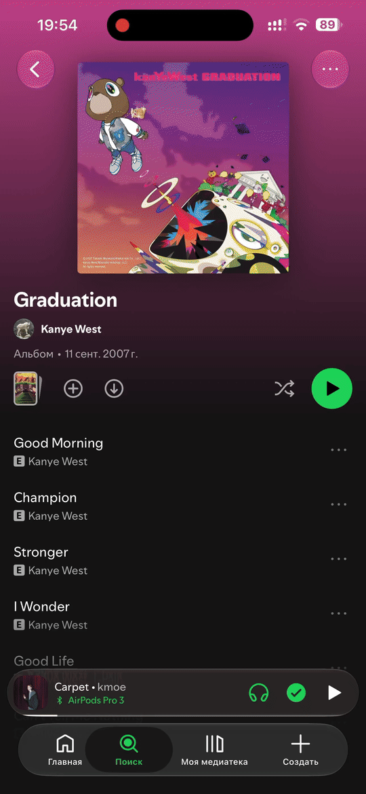

# EeveeSpotify + Pixie Download Manager — UNOFFICIAL FORK

> [!IMPORTANT]
> **This is Glongq's independently maintained fork**, not an official EeveeSpotify or Spotify release.
> Original project: **[SideloadLabs/EeveeSpotifyReincarnated](https://github.com/SideloadLabs/EeveeSpotifyReincarnated)**.

**Current version: Pixie Manager v1.3** · Spotify **9.1.92** · EeveeSpotify **7.0.0**

**Fork maintainer:** [Glongq](https://github.com/Glongq)

**Native-download implementation, integration, documentation and local builds:** OpenAI Codex, under Glongq's direction.

**License:** [GPLv3](LICENSE). Upstream history and contributor attribution are retained.

## What's New

- Updated to Spotify 9.1.92 · Pixie Manager v1.3
- Refactored Pixie code and clarified the source structure for integration

## Pixie

  

English-only settings in **EeveeSpotify → Pixie Download Manager**.

- Native downloads for tracks, albums and playlists, including the current track's album.
- Artist release selection with artwork, category selection, queue/progress and Stop, Continue and Cancel controls.
- Offline-device management with confirmed registration changes and source readback.
- Optional diagnostics, one support-log export and manual log reset. Diagnostics are off by default.
- Spotify's own offline storage and playback remain in use. No MP3/WAV export; WAV capture code has been removed.

## Downloads

**[IPA announcements — @glongqforks](https://t.me/glongqforks)**. This source update uploads no IPA or DEB files.

**[Previous Pixie v1 jailbreak packages](https://github.com/Glongq/EeveeSpotifyReincarnated/releases/tag/pixie-v1)** target Spotify 9.1.88. They have not been rebuilt from the current v1.3 sources. To reproduce those packages, check out tag `pixie-v1` and use its build guide.

GitHub's automatic source archives contain source code, not an installable app.

## Verification and compatibility

Targets Spotify **9.1.92**, ARM64 UUID `2acd33ee445b326d8b75b3e32403790a`, with EeveeSpotify **7.0.0**. Builders validate the UUID and instruction bytes; a matching version label alone is insufficient. Liquid Glass requires iOS 26.

Local IPA builds, signatures, imports and component tests passed. Offline-device tests include the actual Swift Eevee authentication provider with all HTTP intercepted; they do not modify real registrations. Maintainer-supplied device logs confirm completed downloads with the refactored library. Offline playback has not been independently retested for this revision. This target does not rebuild jailbreak packages.

Historical baseline downloads and offline playback were verified by the maintainer through SideStore and LiveContainer on iPhone 15 Pro Max / iOS 27.0.1. These are historical results, not verification of every later build.

## Source and build

See [BUILD-pixie-v1.3.md](BUILD-pixie-v1.3.md) for the current IPA build commands and [source provenance](NativeDownloads/provenance-pixie-v1.3.json) for source hashes. See the [integration and file map](NativeDownloads/docs/INTEGRATION-MAP.md), [module ownership](NativeDownloads/README.md) and [data contracts](NativeDownloads/docs/CONTRACTS.md). Historical tooling remains available in Git history.

## Reporting issues and announcements

- **Announcements:** [@glongqforks](https://t.me/glongqforks).
- **Issues:** [Glongq/EeveeSpotifyReincarnated](https://github.com/Glongq/EeveeSpotifyReincarnated/issues). Include the installation method, Spotify build and iOS version; redact personal data from logs.

## Upstream project and credits

The original EeveeSpotifyReincarnated project is maintained by [jaydenjcpy](https://github.com/jaydenjcpy), [faroukbmiled](https://github.com/faroukbmiled), and [Mod4](https://github.com/M0d-4). Upstream history and contributions also include [estrogencat](https://github.com/estrogencat), [Skye](https://github.com/Meeep1), [whoeevee](https://github.com/whoeevee), and [Spikerko](https://github.com/Spikerko).

Pixie Manager v1.3 was ported from [Glongq/Vitrine-Pixie](https://github.com/Glongq/Vitrine-Pixie) to EeveeSpotify 7.0.0 / Spotify 9.1.92. The native patchers validate the exact Spotify binary and guarded instruction bytes.

**OpenAI Codex** produced the native-download implementation, integration, documentation and local builds under **Glongq's direction**. Glongq performed device testing and supplied feedback. This fork is independent of the upstream maintainers.

[Upstream README](https://github.com/SideloadLabs/EeveeSpotifyReincarnated#readme) · [Contributing](CONTRIBUTING.md) · [Translations](TRANSLATING.md) · [License](LICENSE)

## Disclaimer

This is an unofficial independent modification, not affiliated with, authorized by, or endorsed by Spotify. Use at your own risk. No Spotify application binaries are included in the source repository.
